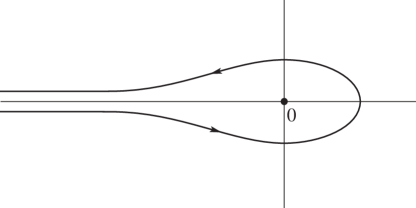

> [!abstract] Integral 1 - 260310
> Evaluate following integral when $\{x\}:=x-\lfloor x\rfloor$.
> $$
> \int_0^\infty\frac{dx}{\left(\{x\}\cdot\text{lcm}\left(\lceil x\rceil,\left\lfloor\frac{1}{\{x\}}\right\rfloor\right)\right)^2}
> $$

> [!done]- Answer 1
> 
> Lebesgue measure of countable set은 $0$이므로, $A=\{n+m^{-1}:1\le n,m\in\mathbb{Z}\}$에 대해 $\mu(A)=0$이다. 적분 구간인 $(0,\infty)$에서 null set을 빼어도 적분 결과에 미치는 영향은 전혀 없으므로, 주어진 적분을 다음과 같은 집합에서 계산하여도 무방하다.
> $$
> (0,\infty)\setminus A=\bigcup_{n=0}^\infty\bigcup_{m=1}^\infty I_{n,m}\qquad\left(I_{n,m}=(n+(m+1)^{-1},n+m^{-1})\right)
> $$
> 
> 그렇다면, 구해야 하는 값은 $J_{n,m}:=\int_{I_{n,m}}\frac{dx}{\left(\{x\}\cdot\text{lcm}\left(\lceil x\rceil,\left\lfloor1/\{x\}\right\rfloor\right)\right)^2}$의 합이다.
> 
> $x\in I_{n.m}$일 때 $n<x<n+1$이므로 $\lfloor x\rfloor=n$, $\lceil x\rceil=n+1$, $\{x\}=x-n$이고, $(m+1)^{-1}<\{x\}<m^{-1}$이므로 $\lfloor 1/\{x\}\rfloor=m$이라는 사실을 알 수 있다. 즉, 구간 $I_{n,m}$에서 피적분함수는 다음과 같은 꼴이다: $\frac{1}{\left((x-n)\cdot\text{lcm}(n+1,m)\right)^2}$. 이를 통해 $J_{n,m}$을 계산해 보자.
> $$
> \begin{aligned}
> J_{n,m}&=\int_{I_{n,m}}\frac{dx}{(x-n)^2\cdot\text{lcm}(n+1,m)^2}=\frac{1}{\text{lcm}(n+1,m)^2}\int_{n+(m+1)^{-1}}^{n+m^{-1}}\frac{dx}{(x-n)^2}\\
> &=\frac{1}{\text{lcm}(n+1,m)^2}\cdot\left.-\frac{1}{x-n}\right|_{x=n+(m+1)^{-1}}^{n+m^{-1}}=\frac{1}{\text{lcm}(n+1,m)^2}.
> \end{aligned}
> $$
> 
> 즉, $\int_0^\infty\frac{dx}{\left(\{x\}\cdot\text{lcm}\left(\lceil x\rceil,\left\lfloor\frac{1}{\{x\}}\right\rfloor\right)\right)^2}=\sum_{n=0}^\infty\sum_{m=1}^\infty J_{n,m}=\sum_{n,m=1}^\infty\text{lcm}(n,m)^{-2}$이다.
> 
> $\mathbb P:=\{0<n\in\mathbb{Z}:n\text{ is prime}\}$으로 두자. $n=\prod_{p\in\mathbb P}p^{n_p}$, $m=\prod_{p\in\mathbb P}p^{m_p}$의 꼴로 표기한다면,
> $$
> \text{lcm}(n,m)=\prod_{p\in \mathbb P}p^{\max(n_p,m_p)}
> $$
> 이다. 즉, 구해야 하는 값은 $\sum_{1\le n,m\in\mathbb{Z}}\prod_{p\in\mathbb P}p^{-2\max(n_p,m_p)}=\prod_{p\in\mathbb P}\sum_{0\le n_p,m_p\in\mathbb{Z}}p^{-2\max(n_p,m_p)}$이다. 각 소수에 대해서 $A(p)=\sum_{a,b=0}^\infty p^{-2\max(a,b)}$를 구할 수 있다면 구해야 하는 값은 $\prod_{p\in\mathbb P} A(p)$라는 것이다.
> 
> 이 $A(p)$를 구하기 위해서 합을 $a<b$, $a=b$, $a>b$ 세 부분으로 쪼개서 구해 보자. 대칭성에 의하여
> $$
> \sum_{0\le a<b}p^{-2\max(a,b)}=\sum_{0\le b<a}p^{-2\max(a,b)}
> $$
> 이 성립하며,
> $$
> \sum_{0\le a<b}p^{-2\max(a,b)}=\sum_{0\le a<b}p^{-2b}=\sum_{a=0}^\infty\sum_{b=a+1}^\infty p^{-2b}=\sum_{a=0}^\infty\frac{p^{-2-2a}}{1-p^{-2}}=\frac{p^{-2}}{(1-p^{-2})^2}.
> $$
> 
> $\sum_{0\le a=b}^\infty p^{-2\max(a,b)}=\sum_{a=0}^\infty p^{-2a}=\frac{1}{1-p^{-2}}$이다. 그러므로 아래와 같이 계산 가능하다.
> $$
> \begin{aligned}
> A(p) &=\sum_{0\le a,b} p^{-2\max(a,b)} = 2\sum_{0\le a<b} p^{-2\max(a,b)}+\sum_{0\le a=b}p^{-2\max(a,b)}=2\frac{p^{-2}}{(1-p^{-2})^2}+\frac{1}{1-p^{-2}}\\
> &=\frac{1+p^{-2}}{(1-p^{-2})^2}=\frac{1-p^{-4}}{(1-p^{-2})^3}.
> \end{aligned}
> $$
> 
> 지금까지의 논의를 종합하면, 적분 $\int_0^\infty\frac{dx}{\left(\{x\}\cdot\text{lcm}\left(\lceil x\rceil,\left\lfloor\frac{1}{\{x\}}\right\rfloor\right)\right)^2}$의 값은 $\prod_{p\in\mathbb P}\frac{1-p^{-4}}{(1-p^{-2})^3}$과 같다. 이 값은 Riemann zeta function에 대한 Euler product $\zeta(s)=\prod_{p\in \mathbb P}\frac{1}{1-p^{-s}}$를 통하여 계산할 수 있다. 잘 알려진 결과 $\zeta(2)=\frac{\pi^2}{6}$, $\zeta(4)=\frac{\pi^4}{90}$[^1]을 이용하면,
> 
> $$
> \begin{aligned}
> \int_0^\infty\frac{dx}{\left(\{x\}\cdot\text{lcm}\left(\lceil x\rceil,\left\lfloor\frac{1}{\{x\}}\right\rfloor\right)\right)^2} &= \prod_{p\in\mathbb P}\frac{1-p^{-4}}{(1-p^{-2})^3}=\frac{\prod_{p\in\mathbb P}(1-p^{-4})}{\left(\prod_{p\in\mathbb P}(1-p^{-2})\right)^3}=\frac{\zeta(2)^3}{\zeta(4)}\\
> &=\boxed{\frac{5\pi^2}{12}}.
> \end{aligned}
> $$
> 
> 별해로, $\sum_{1\le a,b}\operatorname{lcm}(a,b)^{-2}$를 다음과 같이 계산하는 방법도 있다.
> 
> $$
> \begin{aligned}
> \zeta(2)^2=\sum_{1\le a,b}\frac{1}{a^2b^2}&=\sum_{g=1}^\infty\frac{1}{g^4}\sum_{x\perp y}\frac{1}{x^2y^2}=\zeta(4)\sum_{x\perp y}\frac{1}{x^2y^2}\text{이므로,}\\
> \sum_{1\le a,b}\operatorname{lcm}(a,b)^{-2}&=\sum_{g=1}^\infty\sum_{x\perp y}\frac{1}{(gxy)^2}=\zeta(2)\sum_{x\perp y}\frac{1}{x^2y^2}=\zeta(2)^3\zeta(4)^{-1}=\boxed{\frac{5\pi^2}{12}}.
> \end{aligned}
> $$

> [!abstract] Integral 2 - 260317
> Evaluate following integral.
> $$
> \int_0^\infty\int_0^\infty\cdots\int_0^\infty\frac{\log\left(1+\sum_1^n2^{x_i}\right)}{\sum_1^n2^{x_i+\sum_1^n x_i}}dx_1dx_2\cdots dx_n.
> $$

> [!done]- Answer 2
> 변수를 $X_i=2^{-x_i}$로 변환하면, $dX_i=(-\log2)X_idx_i$가 되고 $x_i=0,\infty$일 때 $X_i=1,0$이 각각 성립하므로, 주어진 적분은 $\frac{\log(1+u)}{u}=\int_0^1\frac{dx}{1+ux}$를 사용하여 다음과 같이 변환할 수 있다.
> $$
> \begin{aligned}
> \int_0^\infty\int_0^\infty\cdots\int_0^\infty\frac{\log\left(1+\sum_1^n2^{x_i}\right)}{\sum_1^n2^{x_i+\sum_1^n x_i}}dx_1dx_2\cdots dx_n &= \int_1^0\int_1^0\cdots\int_1^0 \frac{\log(1+\sum_{1}^n X_i^{-1})}{(-\log 2)^n\sum_1^n X_i^{-1}}dX_1dX_2\cdots dX_n\\
> &= (\log2)^{-n}\int_0^1\int_0^1\cdots\int_0^1\frac{\log(1+\sum_1^nX_{i}^{-1})}{\sum_1^nX_{i}^{-1}}dX_1dX_2\cdots dX_n\\
> &= (\log2)^{-n} \int_0^1\cdots\int_0^1\frac{1}{1+X_0\sum_1^nX_{i}^{-1}}dX_0dX_1\cdots dX_n \\
> &= (\log 2)^{-n}\int_0^1\cdots\int_0^1\frac{X/X_0}{\sum_0^n(X/X_i)}dX_0dX_1\cdots dX_n.
> \end{aligned}
> $$
> 
> 단, 위 식에서 $X=\prod_0^n X_i$이다.
> 
> 피적분함수 $f(X_0,X_1,\cdots,X_n):=\frac{X/X_0}{\sum_0^n(X/X_i)}$이라고 하자. 그러면 적분 및 변수의 순서를 바꾸는 것만으로도
> $$\int_{[0,1]^{n+1}}f(X_0,X_1,\cdots,X_n)dX_0dX_1\cdots dX_n=\int_{[0,1]^{n+1}}f(X_i,\cdots,X_n,X_0,\cdots,X_{i-1})dX_0dX_1\cdots dX_n$$이 성립함은 쉽게 보일 수 있다. 또한 $\sum_{\text{cyc}}f(X_0,\cdots,X_n)=1$이므로,
> $$
> \begin{aligned}
> \int_{[0,1]^{n+1}}f(X_0,X_1,\cdots,X_n)dX_0dX_1\cdots dX_n &= \frac{1}{1+n}\int_{[0,1]^{n+1}} \sum_{\operatorname{cyc}}f(X_0,X_1,\cdots,X_n) dX_0dX_1\cdots dX_n\\
> &= \frac{1}{1+n}\int_{[0,1]^{n+1}}dX_0dX_1\cdots dX_n=\frac{1}{1+n}\\
> \end{aligned}
> $$
> 이 성립한다.
> 
> 그러므로,
> $$
> \begin{aligned}
> \int_0^\infty\int_0^\infty\cdots\int_0^\infty\frac{\log\left(1+\sum_1^n2^{x_i}\right)}{\sum_1^n2^{x_i+\sum_1^n x_i}}dx_1dx_2\cdots dx_n &= (\log 2)^{-n}\int_0^1\cdots\int_0^1f(X_0,X_1,\cdots,X_n)dX_0dX_1\cdots dX_n\\
> &=\boxed{\frac{1}{(n+1)(\log2)^n}.}
> \end{aligned}
> $$

> [!abstract] Integral 3 - 260324
> Evaluate following integral.
> $$
> \int_0^\infty e^{-x^2}\sin(x^2)dx.
> $$
> But, you should not use knowledge other than Engineering Mathematics 1, 2 or Calculus and Vector Analysis 1, 2.

> [!done]- Answer 3
> 다음 두 적분을 생각하자:
> $$
> I=\int_0^\infty e^{-x^2}\sin(x^2)dx,\qquad J=\int_0^\infty e^{-x^2}\cos(x^2)dx.
> $$
> 
> 그렇다면 다음과 같이 극좌표 치환을 통하여 $2IJ, J^2-I^2$을 계산할 수 있다.
> 
> ($\frac{\partial(x,y)}{\partial(r,\theta)}=r,$ $\Omega:=\{(x,y):0<x,y\}=\{(r\cos\theta,r\sin\theta):0<r,0<\theta<\pi/2\}.$)
> $$
> \begin{aligned}
> 2IJ&=IJ+JI=\int_0^\infty e^{-x^2}\sin(x^2)dx\int_0^\infty e^{-y^2}\cos(y^2)dy+\int_0^\infty e^{-x^2}\cos(x^2)dx\int_0^\infty e^{-y^2}\sin(y^2)dy\\
> &=\int_0^\infty\int_0^\infty\sin(x^2+y^2)e^{-x^2-y^2}dxdy=\int_0^{\frac\pi2}\int_0^\infty r\sin(r^2)e^{-r^2}drd\theta=\frac12\int_0^\frac\pi2 d\theta\int_0^\infty e^{-u}\sin udu\\
> &=\frac{\pi}{8},\\
> J^2-I^2&=JJ-II=\int_0^\infty e^{-x^2}\cos(x^2)dx\int_0^\infty e^{-y^2}\cos(y^2)dy-\int_0^\infty e^{-x^2}\sin(x^2)dx\int_0^\infty e^{-y^2}\sin(y^2)dy\\
> &=\int_0^\infty\int_0^\infty \cos(x^2+y^2)e^{-x^2-y^2}dxdy=\int_0^\frac\pi2 r\cos(r^2)e^{-r^2}drd\theta=\frac12\int_0^\frac\pi2d\theta\int_0^\infty e^{-u}\cos udu\\
> &=\frac\pi8.
> \end{aligned}
> $$
> 
> $(J^2+I^2)^2=(J^2-I^2)^2+(2IJ)^2=\frac{\pi^2}{32}$이므로 $J^2+I^2=\frac{\pi\sqrt2}{8}$이 성립한다. 그러므로 $I^2=\frac{1}{2}((J^2+I^2)-(J^2-I^2))=\frac{\sqrt2-1}{16}\pi$이 성립하여, 주어진 적분의 답이 $\boxed{\displaystyle \frac{\sqrt{\sqrt2-1}}{4}\sqrt{\pi}}$임을 알 수 있다.
> 
> +) $I>0$인 이유는 아래 수식과 같다. 여기서 $f(x)=e^{-x}/\sqrt x$는 $x\to\infty$일 때 $f(x)\to 0$인 감소함수임은 보이지 않겠으나, 도함수를 취함으로서 어렵지 않게 증명할 수 있다.
> $$
> \begin{aligned}
> I&=\int_0^\infty\frac{e^{-t}\sin t}{\sqrt t}dt=\sum_0^\infty\int_{n\pi}^{(n+1)\pi}f(t)\sin tdt = \sum_0^\infty \int_0^\pi f(t+n\pi)(-1)^n\sin tdt\\
> &=\int_0^{\pi}\sin t\left(\sum_0^\infty(-1)^nf(t+n\pi)\right)dt \ge 0.
> \end{aligned}
> $$
> 
> 여기서 $\sum_0^\infty(-1)^nf(t+n\pi)$는 교대급수 형태이므로, 모든 $0<t<\pi$에 대해 극한이 존재하고 그 극한값이 $0$ 이상임을 Alternating series test로 보일 수 있다.

> [!abstract] Integral 4 - 260331
> Evaluate following integral.
> $$
> \int_0^1 \frac{dx}{(\pi^2+\ln^2x)^2(x+1)^2}.
> $$

> [!done]- Answer 4
> 우선, 주어진 적분에 치환 $t\leftarrow1/x$을 적용하자. 그러면 적분은 다음과 같이 변경된다.
> $$
> \int_0^1\frac{dx}{(\pi^2+\ln^2x)^2(x+1)^2}=\int_{\infty}^1\frac{-dt/t^2}{(\pi^2+(-\ln t)^2)^2+(1/t+1)^2}=\int_1^\infty\frac{dt}{(\pi^2+\ln^2t)^2(t+1)^2}.
> $$
> 즉, 구해야 하는 값은 $I=\int_0^\infty\frac{dt}{(\pi^2+\ln^2t)^2(t+1)^2}$이라 두었을 때 $\frac I2$이다.
> 
> 이제 $I$에 치환 $t\leftarrow e^u$을 적용하자. 그러면 $\ln t=u$이고 $dt/(1+t)^2=e^udu/(1+e^u)^2=du/4\cosh^2(u/2)$가 되므로
> $$
> I=\int_{-\infty}^\infty\frac{1}{4\cosh^2(u/2)}\frac{du}{(\pi^2+u^2)^2}
> $$
> 이 됨을 알 수 있다. 두 함수 $f:u\mapsto\frac{1}{\cosh^2(u/2)},$ $g:u\mapsto\frac{1}{(\pi^2+u^2)^2}$로 두면 $\int_\mathbb{R} fgdu=4I$이며, Fourier transform $\widehat{h}(s)=\int_{\mathbb{R}}h(u)e^{-isu}du$괴 그 inverse $2\pi h(u)=\int_{\mathbb{R}}\widehat h(s)e^{isu}ds$를 이용하여 $\int_\mathbb{R} fgdu$를 다음과 같이 고쳐 쓸 수 있다.
> $$
> \begin{aligned}
> \int_{\mathbb{R}}f(u)g(u)du &=\int_{\mathbb{R}}f(u)\left[\frac{1}{2\pi}\int_{\mathbb{R}}\widehat g(s)e^{isu}ds\right]du = \frac{1}{2\pi}\int_\mathbb{R} \widehat g(s)\left[\int_\mathbb{R} f(u)e^{-i(-s)u}du\right]ds\\
> &=\frac{1}{2\pi}\int_\mathbb{R}\widehat f(-s)\widehat g(s)ds.
> \end{aligned}
> $$
> 또한, 아래 적분을 $x\leftarrow u/2$의 치환으로부터 얻을 수 있다.
> $$
> \widehat f(s)=\int_\mathbb{R} \frac{e^{-isu}du}{\cosh^2(u/2)}=2\int_{\mathbb{R}}\frac{e^{-2isx}dx}{\cosh^2x}
> $$
> 
> 이제 함수 $F(x)=e^{-2isx}/{\cosh^2x}$을 복소평면에서 적분한다고 생각하자. $F(z)$는 $z=(\frac12+n)i\pi$ 지점에서 double pole을 가진다. 양의 실수 $R$에 대하여 직사각형 폐곡선을 따르는 경로 $C_R:R\to R+i\pi\to -R+i\pi\to -R\to R$을 생각하면, $C_R$의 내부에는 pole이 $z=i\pi/2$ 하나만 들어 있다. 이 지점의 유수는 
> $$
> \operatorname{Res}\left(F;\frac{i\pi}{2}\right)=\lim_{z\to\frac{i\pi}2}\frac{d}{dz}\left[\left(z-\frac{i\pi}{2}\right)^2\frac{e^{-2isz}}{\cosh^2z}\right].
> $$
> 
> 극한값을 구하기 위해서 $w=z-i\pi/2$로 치환하자. $e^{-2isz}=e^{s\pi}e^{-2isw}$이며, $1/\cosh^2z=1/\cosh^2(w+i\pi/2)=1/(i\sinh w)^2=-1/\sinh^2w$이고, $\sinh^2w$의 급수 전개는 다음과 같다:
> $$
> \sinh^2w=-\frac12+\frac12\cosh2w=\sum_1^\infty\frac{2^{2k-1}w^{2k}}{(2k)!}=w^2+\frac{w^4}{3}+\mathcal O(w^5)
> $$
> 
> 그러므로,
> $$
> \begin{aligned}
> \lim_{z\to\frac{i\pi}2}\frac{d}{dz}\left[\left(z-\frac{i\pi}{2}\right)^2\frac{e^{-2isz}}{\cosh^2z}\right]&=\lim_{w\to 0}\frac{d}{dw}\left[-w^2\frac{e^{s\pi}e^{-2isw}}{\sinh^2w}\right]=-e^{s\pi}\lim_{w\to 0}\frac{d}{dw}\left[w^2\frac{1-2isw-2s^2w^2+\mathcal O(w^3)}{w^2+w^4/3+\mathcal O(w^5)}\right]\\
> &=-e^{s\pi}\lim_{w\to 0}\frac{d}{dw}\frac{1-2isw-2s^2w^2+\mathcal O(w^3)}{1+w^2/3+\mathcal O(w^3)}\\
> &=-e^{s\pi}\lim_{w\to 0}\frac{d}{dw}(1-2isw-2s^2w^2+\mathcal O(w^3))(1-w^2/3+\mathcal O(w^3))\\
> &=-e^{s\pi}\lim_{w\to 0}\frac{d}{dw}(1-2isw+\mathcal O(w^2))=-e^{s\pi}\lim_{w\to 0}\frac{d}{dw}(-2is+\mathcal O(w))\\
> &=2ise^{s\pi}.
> \end{aligned}
> $$
> 
> 유수는 $2ise^{s\pi}$가 됨을 알 수 있다. 이제 $C_R$을 네 경로 $C_1:-R\to R,$ $C_2:R+i\pi\to-R+i\pi,$ $C_3:R\to R+i\pi,$ $C_4:-R+i\pi\to R$로 분해해 보면, $R\to \infty$일 때 $\int_{C_3}F(z)dz,\int_{C_4}F(z)dz\to 0$이며, $F(z+i\pi)=e^{2s\pi}F(z)$이 성립하기 때문에 $\int_{C_2}F(z)dz=-e^{2s\pi}\int_{C_1}F(z)dz$가 됨을 알 수 있다. 실수부가 반대 방향으로 이동하고 있으므로 부호가 바뀌었음에 유의하라. 즉,
> $$
> \lim_{R\to\infty}\oint_{C_R}F(z)dz=(1-e^{2s\pi})\lim_{R\to\infty}\int_{-R}^RF(z)dz=\frac12(1-e^{2s\pi})\widehat{f}(s)
> $$
> 이 성립하고, 이 적분의 값은 $2\pi i\operatorname{Res}\left(F;\frac{i\pi}{2}\right)=-4\pi se^{s\pi}$. 곧
> $$
> \widehat f(s)=\frac{-4\pi se^{\pi s}}{\frac12(1-e^{2\pi s})}=\frac{4\pi s}{\sinh \pi s}.
> $$
> 
> 또한,
> $$
> \begin{aligned}
> \frac{1}{2\pi}\int_\mathbb{R} e^{-a|u|}e^{isu}ds &= \frac{1}{2\pi} \left[ \int_{-\infty}^{0} e^{au} e^{isu} du + \int_{0}^{\infty} e^{-au} e^{isu} du \right] = \frac{1}{2\pi} \left( \frac{1}{a+is} + \frac{1}{a-is} \right)\\
> &= \frac{1}{\pi} \frac{a}{a^2 + s^2}
> \end{aligned}
> $$
> 이므로 $\widehat{\frac{1}{a^2+s^2}}=\pi e^{-a|s|}$이다. 양 변에 $\partial/\partial a$를 취하면, 좌변은 $-2a\widehat{\frac{1}{(a^2+u^2)^2}}$이 되며, 우변은 $\frac{\pi}{a^2}e^{-a|s|}(1+a|s|)$이 된다. 결론적으로, $\widehat{\frac{1}{(a^2+u^2)^2}}=\frac{\pi}{2a^3}(1+a|s|)e^{-a|s|}$이며, $a\leftarrow \pi$로부터 $\widehat{g}(s)$를 얻을 수 있다.
> $$
> \widehat{g}(s)=\frac{1}{2\pi^2}(1+\pi|s|)e^{-\pi|s|}.
> $$
> 
> $4I=\int_\mathbb{R} fgdu=\frac{1}{2\pi}\int_\mathbb{R}\widehat f(-s)\widehat g(s)ds$임과 $f,g$의 Fourier transform 결과를 합치면 $I$를 얻을 준비가 완료된 셈이다. $\widehat f,\widehat g$가 모두 even function이므로, $8\pi I=\int_\mathbb{R}\widehat f(-s)\widehat g(s)ds=2\int_0^\infty\widehat f(s)\widehat g(s)ds$임을 얻을 수 있다.
> 
> $$
> \begin{aligned}
> 4\pi I&=\int_0^\infty\widehat f(s)\widehat g(s)ds = \int_0^\infty\frac{4\pi s}{\sinh\pi s}\cdot\frac{1}{2\pi^2}(1+\pi s)e^{-\pi s}ds = \frac2{\pi}\int_0^\infty\frac{s+\pi s^2}{e^{\pi s}\sinh \pi s}ds\\
> \pi^2 I&=\int_0^\infty\frac{sds}{e^{2\pi s}-1}+\pi\int_0^\infty\frac{s^2ds}{e^{2\pi s}-1}
> \end{aligned}
> $$
> 
> $J(a,p):=\int_0^\infty\frac{x^{p-1}}{e^{ax}-1}dx$라고 하자. 그렇다면 $\pi^2 I=J(2\pi,2)+\pi J(2\pi,3)$이다. $J(a,p)$의 값은 아래와 같은 방법으로 구할 수 있다.
> $$
> \begin{aligned}
> J(a,p) &= a^{-p}\int_0^\infty\frac{(ax)^{p-1}}{e^{ax}-1}adx=a^{-p}\int_0^\infty\frac{z^{p-1}e^{-z}}{1-e^{-z}}dz = a^{-p}\int_0^\infty z^{p-1}\left(\sum_{n=1}^\infty e^{nz}\right)dz\\
> &=a^{-p}\sum_{n=1}^\infty\left(\int_0^\infty e^{nz}z^{p-1}dz\right) = a^{-p}\sum_{n=1}^\infty n^{-p}\left(\int_0^\infty e^{nz}(nz)^{p-1}ndz\right)\\
> &= a^{-p}\sum_{n=1}^\infty n^{-p}\left(\int_0^\infty w^{p-1}e^wdw\right)=a^{-p}\sum_{n=1}^\infty\frac{\Gamma(p)}{n^p}=\frac{\Gamma(p)\zeta(p)}{a^p}.
> \end{aligned}
> $$
> 
> 그러므로, 적분값 $I$는 다음과 같은 값이 됨을 알 수 있다.
> $$
> \begin{aligned}
> I &= \frac{1}{\pi^2}\left(J(2\pi,2)+\pi J(2\pi,3)\right) = \frac{1}{\pi^2}\left(\frac{\Gamma(2)\zeta(2)}{(2\pi)^2}+\pi\frac{\Gamma(3)\zeta(3)}{(2\pi)^3}\right)\\
> &=\frac{1}{\pi^2}\left(\frac{1\cdot\pi^2/6}{4\pi^2}+\pi\frac{2\zeta(3)}{8\pi^3}\right) = \frac{1}{\pi^2}\left(\frac{1}{24}+\frac{\zeta(3)}{4\pi^2}\right)\\
> &= {\frac{6\zeta(3)+\pi^2}{24\pi^4}}.
> \end{aligned}
> $$
> 구하는 값은 $\displaystyle \frac I2=\boxed{\frac{6\zeta(3)+\pi^2}{48\pi^4}}$이다.

> [!abstract] Integral 5 - 260407
> Evaluate following integral.
> $$
> \int\frac{\cos^2x+\cos\sin x}{1+\sin x\sin\sin x}dx.
> $$

> [!done]- Answer 5
> 피적분함수의 분모에 반각공식을 사용하면, $a=\frac{x+\sin x}{2}, b=\frac{x-\sin x}{2}$를 이용하여 다음과 같이 식변형을 할 수 있다.
> $$
> \begin{aligned}
> 1+\sin x\sin\sin x &= \frac12\left[\cos(x-\sin x)-\cos(x+\sin x)\right]+1=\frac12(\cos 2b-\cos 2a)+1\\
> &= \frac{1-\cos 2a}{2}+\frac{1+\cos 2b}{2}=\sin^2a+\cos^2b
> \end{aligned}
> $$
> 
> 또한, $\cos\sin x$를 $a,b$를 사용하여 나타내면, $1+\cos x=\frac{da}{dx}$이고 $1-\cos x=\frac{db}{dx}$ 이므로 분자도 다음과 같이 변형할 수 있다.
> $$
> \begin{aligned}
> \cos^2x+\cos\sin x&=\cos x\cos(a+b)+\cos(a-b) = (1+\cos x)\cos a\cos b+(1-\cos x)\sin a\sin b\\
> &=2\cos b\frac{d\sin a}{dx}-2\sin a\frac{d\cos b}{dx}
> \end{aligned}
> $$
> 
> 이제 분모와 분자를 동시에 $\sin^2 a$로 나누면, 적분을 다음과 같이 계산할 수 있다.
> $$
> \begin{aligned}
> \int\frac{\cos^2x+\cos\sin x}{1+\sin x\sin\sin x}dx &= \int\frac{2\cos b\frac{d\sin a}{dx}-2\sin b\frac{d\cos a}{dx}}{\sin^2 a+\cos^2 b}dx\\
> &= \int\frac{1}{1+(\cos b/\sin a)^2}\left(2\cos b\frac{1}{\sin^2a}\frac{d\sin a}{dx}-\frac{2}{\sin a}\frac{d\cos b}{dx}\right)dx \\
> &= \int\frac{1}{1+(\cos b/\sin a)^2}\left(-2\cos b\frac{d(1/\sin a)}{dx}-2\left(\frac1{\sin a}\right)\frac{d\cos b}{dx}\right)dx \\
> &= -2\int\frac{1}{1+(\cos b/\sin a)^2}\frac{d(\cos b/\sin a)}{dx}dx\\
> &= -2\arctan(\cos b/\sin a)+C = \boxed{-2\arctan\left(\frac{\cos\frac{x-\sin x}{2}}{\sin\frac{x+\sin x}{2}}\right) +C}.
> \end{aligned}
> $$

> [!abstract] Integral 6 - 260414
> Evaluate following integral.
> $$
> \int\frac{2n!\sin x+x^n}{e^x+\sin x+\cos x+1+x+\frac{x^2}{2}+\cdots+\frac{x^n}{n!}}dx.
> $$

> [!done]- Answer 6
> 피적분함수의 분모를 $f(x):=e^x+\sin x+\cos x+1+x+\frac{x^2}2+\cdots\frac{x^n}{n!}$으로 두자. 그러면 $f'(x)=e^x-\sin x+\cos x+1+x+\frac{x^2}{2}+\cdots\frac{x^{n-1}}{(n-1)!}=f(x)-2\sin x-\frac{x^n}{n!}$.
> 
> 그러므로 피적분함수의 분자는 $2n!\sin x+x^n=n!(f(x)-f'(x))$이다. 이를 이용하면 주어진 적분은 다음과 같이 깔끔하게 계산할 수 있다.
> $$
> \begin{aligned}
> \int\frac{2n!\sin x+x^n}{e^x+\sin x+\cos x+1+x+\frac{x^2}{2}+\cdots+\frac{x^n}{n!}}dx &=\int n!\frac{f(x)-f'(x)}{f(x)}dx=n!\int\left(1-\frac{f'(x)}{f(x)}\right)dx\\
> &= n!(x-\ln |f(x)|)+C\\
> &= \boxed{n!\left(x-\ln\left|e^x+\sin x+\cos x+1+x+\frac{x^2}{2}+\cdots+\frac{x^n}{n!}\right|\right)+C}.
> \end{aligned}
> $$

> [!abstract] Integral 7 - 260421
> Evaluate following integral.
> $$
> \int\frac{x(2x+3)\sqrt[3]{x+1}}{x^6+x^2+2x+1}dx.
> $$

> [!done]- Answer 7
> 피적분함수의 분모와 분자를 $x^6$으로 나누면 식은 다음과 같이 변형된다.
> $$
> \frac{x(2x+3)\sqrt[3]{x+1}}{x^6+x^2+2x+1}=(2x^{-3}-3x^{-4})\frac{\sqrt[3]{x^{-2}+x^{-3}}}{1+(x^{-2}+x^{-3})^2}
> $$
> 
> 또한 $\frac{d}{dx}(x^{-2}+x^{-3})=-2x^{-3}-3x^{-4}$이므로, $u\leftarrow x^{-2}+x^{-3}$의 치환을 적용하면 주어진 적분은 $-\int\frac{u^{-1/3}}{u^2+1}du$이 된다. 다시 $t\leftarrow u^{2/3}$으로 치환하면 $u^{1/3}du=u^{2/3}(u^{-1/3}du)=\frac32 tdt$가 되니, 주어진 적분은 $-\frac32\int\frac{t}{t^3+1}dt$가 된다.
> 
> $I=\int\frac{t}{1+t^3}dt$, $J=\int\frac{1}{1+t^3}dt$로 두면,
> $$
> \begin{aligned}
> I+J &= \int\frac{1+t}{1+t^3}dt=\int\frac{1}{1-t+t^2}dt=\int\frac{1}{\frac34+\left(t-\frac12\right)^2}dt=\frac{2}{\sqrt3}\tan^{-1}\frac{2t-1}{\sqrt3}+C\\
> -I+J &= \int\frac{1-t}{1+t^3}dt = \int\frac{1}{1+t}dt-\int\frac{t^2}{1+t^3}dt=\ln|1+t|-\frac13\ln|1+t^3|+C
> \end{aligned}
> $$
> 이므로,
> $$
> I=\frac{1}{\sqrt3}\tan^{-1}\frac{2t-1}{\sqrt3}-\frac12\ln|1+t|+\frac16\ln|1+t^3|+C.
> $$
> 
> 즉, 구하는 적분은 다음과 같다.
> $$
> \begin{aligned}
> \int \frac{x(2x+3)\sqrt[3]{x+1}}{x^6+x^2+2x+1}dx &= -\frac32 I=-\frac{3}{2\sqrt3}\tan^{-1}\frac{2t-1}{\sqrt3}-\frac34\ln|1+t|+\frac14\ln|1+t^3|+C\\
> &= -\frac{3}{2\sqrt3}\tan^{-1}\frac{2u^{2/3}-1}{\sqrt3}-\frac34\ln|1+u^{2/3}|+\frac14\ln|1+u^2|+C \\
> &= \boxed{-\frac{3}{2\sqrt3}\tan^{-1}\frac{2\left(x^{-2}+x^{-3}\right)^{2/3}-1}{\sqrt3}-\frac34\ln\left|1+\left(x^{-2}+x^{-3}\right)^{2/3}\right|+\frac14\ln\left|1+\left(x^{-2}+x^{-3}\right)^2\right|+C}.
> \end{aligned}
> $$

> [!abstract] Integral 8 - 260428
> Evaluate following integral.
> $$
> \int_0^\infty\frac{\left(\sin \frac{e^2x}{4}-\cos \frac{e^4x}{4}\right)\ln x}{\sqrt x}dx.
> $$

> [!done]- Answer 8
> 일반적인 상수 $a(>0)$에 대해서 $S_a=\int_0^\infty \frac{\sin ax \ln x}{\sqrt x}dx$과 $C_a=\int_0^\infty \frac{\cos ax \ln x}{\sqrt x}dx$을 구할 수 있으면, 이를 통해서 주어진 적분의 값이 $S_{e^2/4}-C_{e^4/4}$임을 알 수 있다. 그러므로 $S_a, C_a$의 값을 구해 보도록 하자.
> 
> $\sin ax$의 Mellin transform $\mathcal M(\sin ax):=\int_0^\infty x^{p-1}\sin axdx$의 양 변을 $p$에 대해 편미분하면 $\frac{\partial}{\partial p}\mathcal M(\sin ax)=\int_0^\infty \frac{\partial}{\partial p}x^{p-1}\sin axdx=\int_0^\infty x^{p-1}\sin ax\ln xdx$이므로, $S_a=\left.\frac{\partial}{\partial p}\mathcal M(\sin ax)\right|_{p=1/2}$임을 알 수 있으며, 정확히 같은 방식으로 $C_a=\left.\frac{\partial}{\partial p}\mathcal M(\cos ax)\right|_{p=1/2}$임 또한 알 수 있다. 그러므로 $\sin ax,\cos ax$의 Mellin transform을 구하면 된다.
> 
> 이를 구하기 위해서는 Laplace transform의 다음과 같은 성질이 유용하게 쓰인다:
> $$
> \begin{aligned}
> \int_0^\infty f(x)\mathcal L g(x)dx &= \int_0^\infty f(x)\left[\int_0^\infty e^{-tx}g(t)dt\right]dx = \int_0^\infty\int_0^\infty e^{-tx}f(x)g(t)dtdx\\
> &= \int_0^\infty g(t)\left[\int_0^\infty e^{-tx}f(x)dx\right]dt=\int_0^\infty \mathcal L f(t)g(t)dt.
> \end{aligned}
> $$
> 여기에 $f(x)=\sin ax,$ $\mathcal Lg(x)=x^{p-1}$을 대입하면, Laplace transform of $x^{a-1}$이 $\Gamma(a)s^{-a}$이기 때문에 $g(t)=\frac{t^{-p}}{\Gamma(1-p)}$이 성립하며, $\mathcal Lf(t)=\frac{a}{a^2+t^2}$이 역시 성립한다. 그러므로
> $$
> \mathcal M(\sin ax)=\int_0^\infty x^{p-1}\sin axdx=\int_0^\infty f(x)\mathcal Lg(x)dx=\int_0^\infty\mathcal Lf(t)g(t)dt=\frac{a}{\Gamma(1-p)}\int_0^\infty\frac{t^{-p}}{a^2+t^2}dt.
> $$
> 또한 $f(x)=\cos ax$를 사용할 때 $\mathcal Lf(x)=\frac{t}{a^2+t^2}$임을 대입하면 다음과 같은 식 역시 얻을 수 있다.
> $$
> \mathcal M(\cos ax)=\frac{1}{\Gamma(1-p)}\int_0^\infty\frac{t^{1-p}}{a^2+t^2}dt.
> $$
> 
> 이제 위 두 개의 적분을 한 번에 계산하기 위해서 $I_z=\int_0^\infty\frac{t^z}{a^2+t^2}dt$를 $-1<z<1$ 범위에서 계산해 보자. $t\leftarrow au$의 치환을 적용하면 $$
> I_z=\int_0^\infty\frac{a^zu^z}{a^2(1+u^2)}\cdot adu=a^{z-1}\int_0^\infty\frac{u^z}{1+u^2}du
> $$
> 가 성립하며, 다시 한 번 $v\leftarrow \sqrt u$의 치환을 적용하면
> $$
> I_z=a^{z-1}\int_0^\infty\frac{v^{z/2}}{1+v}\cdot\frac{dv}{2\sqrt v}=\frac{a^{z-1}}{2}\int_0^\infty\frac{v^{(z-1)/2}}{1+v}dv
> $$
> 임을 알 수 있다.
> 
> Beta function $\mathrm{B}(x,y)=\int_0^1u^{x-1}(1-u)^{y-1}du$에 $u\leftarrow t/(1+t)$ 치환을 적용하면,
> $$
> \mathrm{B}(x,y)=\int_0^\infty\left(\frac{t}{1+t}\right)^{x-1}\left(\frac{1}{t+1}\right)^{y-1}\cdot\frac{1}{(t+1)^2}dt=\int_0^\infty\frac{t^{x-1}}{(1+t)^{x+y}}dt
> $$
> 임을 얻을 수 있으며, 이를 통하여 $I_z$를 다음과 같이 정리할 수 있다:
> $$
> I_z=\frac{a^{z-1}}{2}\mathrm{B}\left(\frac{z+1}{2},\frac{-z+1}{2}\right).
> $$
> 
> 
> $\mathrm B(x,y)=\frac{\Gamma(x)\Gamma(y)}{\Gamma(x+y)}$와, reflection formula of Gamma function $\Gamma(z)\Gamma(1-z)=\pi\csc(\pi z)$를 이용하면 $I_z$를 다음과 같이 정리할 수 있다:
> $$
> I_z =\frac{a^{z-1}}{2}\frac{\Gamma\left(\frac{z+1}{2}\right)\Gamma\left(\frac{-z+1}{2}\right)}{\Gamma(1)}=\frac{a^{z-1}}{2}\pi\csc\left(\frac{\pi z+\pi}{2}\right)=\frac{a^{z-1}}{2}\pi\sec\frac{\pi z}{2}.
> $$
> 
> 그러므로 다음과 같은 식이 성립한다:
> $$
> \begin{aligned}
> \mathcal M(\sin ax) &=\frac{a}{\Gamma(1-p)}I_{-p}=\frac{a^{-p}\pi}{2\Gamma(1-p)\cos\frac{\pi p}{2}}=\frac{a^{-p}}{2\cos\frac{\pi p}{2}}\frac{\Gamma(p)}{\csc\pi p}=a^{-p}\Gamma(p)\sin\frac{\pi p}{2}\\
> \mathcal M(\cos ax) &=\frac{1}{\Gamma(1-p)}I_{1-p}=\frac{a^{-p}\pi}{2\Gamma(1-p)\cos\frac{\pi(1-p)}{2}}=\frac{a^{-p}}{2\sin\frac{\pi p}{2}}\frac{\Gamma(p)}{\csc\pi p}=a^{-p}\Gamma(p)\cos\frac{\pi p}{2}.
> \end{aligned}
> $$
> 
> 따라서, 이를 $p$로 편미분한 뒤 $p=\frac12$를 대입하면 다음과 같은 식을 얻을 수 있다:
> $$
> \begin{aligned}
> S_a &=\left.\frac{\partial}{\partial p}\mathcal M(\sin ax)\right|_{p=1/2}=\left.\frac{\partial}{\partial p}a^{-p}\Gamma(p)\sin\frac{\pi p}{2}\right|_{p=1/2}\\
> &=\left.-a^{-p}\Gamma(p)\sin\frac{\pi p}{2}\ln a+a^{-p}\Gamma'(p)\sin\frac{\pi p}{2}+\frac{\pi}{2}a^{-p}\Gamma(p)\cos\frac{\pi p}{2}\right|_{p=1/2}\\
> &=a^{-\frac12}\left(-\Gamma\left(\frac12\right)\sin\frac{\pi}{4}\ln a+\Gamma'\left(\frac12\right)\sin\frac{\pi}{4}+\frac\pi 2\Gamma\left(\frac12\right)\cos\frac{\pi}{4}\right)\\
> &= \frac{\sqrt{\pi}}{\sqrt{2a}}\left(-\ln a+\frac{\Gamma'(1/2)}{\Gamma(1/2)}+\frac{\pi}{2}\right).\\
> C_a &= \left.\frac{\partial}{\partial p}\mathcal M(\cos ax)\right|_{p=1/2}=\left.\frac{\partial}{\partial p}a^{-p}\Gamma(p)\cos\frac{\pi p}{2}\right|_{p=1/2}\\
> &=\left.-a^{-p}\Gamma(p)\cos\frac{\pi p}{2}\ln a+a^{-p}\Gamma'(p)\cos\frac{\pi p}{2}-\frac{\pi}{2}a^{-p}\Gamma(p)\sin\frac{\pi p}{2}\right|_{p=1/2}\\
> &= a^{-\frac12}\left(-\Gamma\left(\frac12\right)\cos\frac\pi4\ln a+\Gamma'\left(\frac12\right)\cos\frac\pi4-\frac\pi2\Gamma\left(\frac12\right)\sin\frac\pi4\right)\\
> &=\frac{\sqrt{\pi}}{\sqrt{2a}}\left(-\ln a+\frac{\Gamma'(1/2)}{\Gamma(1/2)}-\frac{\pi}{2}\right).
> \end{aligned}
> $$
> 
> 위 식에서 처리하지 못한 $\frac{\Gamma'(1/2)}{\Gamma(1/2)}$을 계산하기 위해서 Gamma function의 Euler infinite product을 이용하자. $\Gamma(z)=\lim_{n\to\infty}\frac{n^zn!}{z(z+1)(z+2)\cdots(z+n)}$의 양 변에 자연로그를 씌우면 다음과 같은 식이 얻어진다:
> $$
> \ln\Gamma(z)=\lim_{n\to\infty}\left(z\log n+\log n!-\sum_0^n\log(z+k)\right).
> $$
> 이 식의 양 변을 미분하면 다음과 같이 변형된다:
> $$
> \begin{aligned}
> \frac{\Gamma'(z)}{\Gamma(z)}&=\frac{d}{dz}\ln\Gamma(z)=\lim_{n\to\infty}\left(\log n-\sum_0^n\frac{1}{z+k}\right)=\lim_{n\to\infty}\left(\log n-\sum_0^{n}\frac 1{k+1}\right)-\lim_{n\to\infty}\sum_0^n\left(\frac{1}{z+k}-\frac{1}{1+k}\right)\\
> &=-\gamma-\sum_0^\infty\left(\frac{1}{z+k}-\frac{1}{1+k}\right).
> \end{aligned}
> $$
> $z=\frac12$를 대입하면,
> $$
> \begin{aligned}
> \frac{\Gamma'(1/2)}{\Gamma(1/2)} &= -\gamma - \sum_0^\infty\left(\frac{1}{1/2+k}-\frac{1}{1+k}\right) = -\gamma-2\sum_0^\infty\left(\frac{1}{1+2k}-\frac{1}{2+2k}\right) = -\gamma+2\sum_1^\infty\frac{(-1)^k}{k}\\
> &= -\gamma-\ln4.
> \end{aligned}
> $$
> 그러므로,
> $$
> S_a=\sqrt{\frac{\pi}{2a}}\left(-\gamma-\ln4a+\frac{\pi}{2}\right),\qquad C_a=\sqrt{\frac{\pi}{2a}}\left(-\gamma-\ln4a-\frac{\pi}{2}\right).
> $$
> 
> 문제에서 요구하는 값은 $S_{e^2/4}-C_{e^4/4}$이었으므로,
> $$
> \begin{aligned}
> \int_0^\infty\frac{\left(\sin\frac{e^2x}{4}-\cos\frac{e^4x}{4}\right)\ln x}{\sqrt x}dx &= S_{e^2/4}-C_{e^4/4} = \sqrt{\frac{\pi}{e^2/2}}\left(-\gamma-\ln e^2+\frac\pi 2\right)-\sqrt{\frac{\pi}{e^4/2}}\left(-\gamma-\ln e^4-\frac{\pi}{2}\right) \\
> &= \boxed{\frac{\sqrt{2\pi}}{e^2}\left((1-e)\gamma+\frac{(e+1)\pi}{2}+4-2e\right)}.
> \end{aligned}
> $$

> [!abstract] Integral 9 - 260505
> Evaluate following integral.
> $$
> \int_0^\frac{\pi}{2}x\sqrt{\tan x}dx.
> $$

> [!done]- Answer 9
> 적분 $\int_0^{\frac\pi 2}x\sqrt{\tan x}dx$를 구하기 위해 다음과 같은 적분을 생각하자:
> $$
> I(t):=\int_0^{\frac\pi 2}\arctan(t\tan x)\sqrt{\tan x}dx
> $$
> $I(0)=0$임은 자명하고, $I$의 도함수는 다음과 같이 구할 수 있다.
> $$
> \begin{aligned}
> I'(t)&=\frac{d}{dt}\int_0^{\frac\pi2}\arctan(t\tan x)\sqrt{\tan x}dx=\int_0^{\frac\pi2}\frac{\partial}{\partial t}\arctan(t\tan x)\sqrt{\tan x}dx\\
> &=\int_0^{\frac{\pi}{2}}\frac{\tan x}{1+t^2\tan^2x}\sqrt{\tan x}dx\\
> &=\int_0^\infty\frac{v\sqrt v}{(1+v^2)(1+t^2 v^2)}dv&&(v\leftarrow \tan x)\\
> &=\int_0^\infty\frac{2u^4}{(1+u^4)(1+t^2u^4)}=\frac{2}{t^2-1}\left[\int_0^\infty\frac{1}{1+u^4}du-\int_0^\infty\frac{1}{1+t^2u^4}du\right]&&(u\leftarrow\sqrt v)
> \end{aligned}
> $$
> 
> Beta function에 관한 다음 식 $\mathrm{B}(x,y)=\int_0^\infty\frac{t^{y-1}}{(1+t)^{x+y}}dt$를 이용하면 위 식에서 얻은 두 적분을 다음과 같이 계산할 수 있다.
> $$
> \begin{aligned}
> \int_0^\infty\frac{1}{1+u^4}du &= \int_0^\infty\frac{\frac14t^{-\frac34}}{1+t}dt=\frac{1}{4}\mathrm{B}\left(\frac14,\frac34\right)=\frac{\Gamma(1/4)\Gamma(3/4)}{4\Gamma(1)} =\frac{\pi}{4\sin\frac\pi4}=\frac{\pi}{2\sqrt 2}&&(t\leftarrow u^4)\\
> \int_0^\infty\frac{1}{1+t^2u^4}du &= \int_0^\infty\frac{t^{-\frac12}}{1+w^4}dw=\frac{\pi}{2\sqrt{2}\sqrt{t}}&&(w\leftarrow\sqrt tu)
> \end{aligned}
> $$
> 
> 그러므로,
> $$
> I'(t)=\frac{2}{t^2-1}\left(\frac{\pi}{2\sqrt2}-\frac{\pi}{2\sqrt2\sqrt t}\right)=\frac{\pi}{\sqrt 2}\left(\frac{1}{t^2-1}\cdot\frac{\sqrt t-1}{\sqrt t}\right)=\frac{\pi}{\sqrt2}\frac{1}{\sqrt t(1+t)(1+\sqrt t)}
> $$
> 이 됨을 알 수 있다.
> 
> 구하는 값은 $I(1)$이므로, $I'(t)$를 $0$부터 $1$까지 적분해 주면 된다.
> $$
> \begin{aligned}
> \int_0^{\frac\pi 2}x\sqrt{\tan x}dx=I(1) &= \int_0^1 I'(t)dt=\frac{\pi}{\sqrt 2}\int_0^1\frac{1}{\sqrt t(1+t)(1+\sqrt t)}dt=\frac{\pi}{\sqrt 2}\int_0^1\frac{2}{(x+1)(x^2+1)}dx\\
> &=\frac{\pi}{\sqrt 2}\left(\int_0^1\frac{1}{x+1}dx-\int_0^1\frac{x}{x^2+1}dx+\int_0^1\frac{1}{x^2+1}dx\right)&&(x\leftarrow\sqrt t)\\
> &=\frac{\pi}{\sqrt 2}\left(\left.\log (x+1)\right|_0^1-\left.\frac12\log(1+x^2)\right|_0^1+\left.\arctan x\right|_0^1\right)\\
> &=\boxed{\frac{\pi}{4\sqrt 2}(2\ln 2+\pi)}.
> \end{aligned}
> $$

> [!abstract] Integral 10 - 260512
> Evaluate following integral when $\phi$ is golden ratio $\frac{1+\sqrt5}{2}$.
> $$
> \int_0^{\log\phi}\log(e^x-e^{-x})dx.
> $$

> [!done]- Answer 10
> 우선 주어진 적분을 $u\leftarrow e^{x}$로 치환하면 다음과 같은 식을 얻는다:
> $$
> I:=\int_0^{\log\phi}\log(e^x-e^{-x})dx=\int_1^\phi\frac{\log(u-u^{-1})}{u}du=\int_1^\phi\frac{\log(u^2-1)}{u}du-\int_1^\phi\frac{\log u}{u}du.
> $$
> 여기서 $z=u^2-1$로 치환하면 $\int_1^\phi\frac{\log(u^2-1)}{u}du=\int_1^\phi\frac{\log(u^2-1)}{u^2}udu=\frac12\int_0^\phi\frac{\log z}{z+1}dz$임을 알 수 있다. $J:=\int_0^\phi\frac{\log z}{z+1}dz$로 두면, $I=\frac{J}{2}-\frac12\log^2\phi$이다. 또한 $I=\int_1^\phi\frac{\log(u^2-1)}{u}du-\frac12\log^2\phi$를 변형시켜 보면 다음과 같은 결과를 얻을 수 있다:
> 
> $$
> \begin{aligned}
> I&=\int_1^\phi\frac{\log(u^2-1)}{u}du-\frac12\log^2\phi=\int_1^\phi\frac{\log(u-1)}{u}du+\int_1^\phi\frac{\log(u+1)}{u}du-\frac{1}{2}\log^2\phi\\
> &=\int_0^{\phi-1}\frac{\log z}{1+z}dz+\left(\left.\log u\log(u+1)\right|_1^\phi-\int_1^\phi\frac{\log u}{u+1}du\right)-\frac{1}{2}\log^2\phi&&(z\leftarrow u-1\text{ \& IBP})\\
> &= \int_0^{1}\frac{\log z}{1+z}dz-\int_{\phi^{-1}}^1\frac{\log z}{1+z}dz+\log\phi\log\phi^2-\int_1^\phi\frac{\log w}{1+w}dw-\frac{1}{2}\log^2\phi\\
> &= \int_0^{1}\frac{\log z}{1+z}dz-\int^1_\phi\frac{\log w^{-1}}{1+w^{-1}}(-w^2dw)-\int_1^\phi\frac{\log w}{1+w}dw+\frac32\log^2\phi&&(w\leftarrow z^{-1})\\
> &= \int_0^1\frac{\log z}{1+z}dz+\int_1^\phi\frac{\log w}{w(w+1)}dw-\int_1^\phi\frac{\log w}{1+w}dw+\frac32\log^2\phi\\
> &= \int_0^1\frac{\log z}{1+z}dz+\int_1^\phi\frac{\log w}{w}dw-2\int_1^\phi\frac{\log w}{1+w}dw+\frac32\log^2\phi\\
> &= 3\int_0^1\frac{\log z}{1+z}-2\int_0^\phi\frac{\log w}{1+w}dw+2\log^2\phi\\
> &= 3\int_0^1\frac{\log z}{1+z}+2\log^2\phi -2J.
> \end{aligned}
> $$
> 
> 또한, $\int_0^1\frac{\log z}{1+z}dz$는 다음과 같이 계산 가능하다:
> $$
> \begin{aligned}
> \int_0^1\frac{\log z}{1+z}dz &= \int_0^1\log z\sum_0^\infty(-z)^ndz=\sum_0^\infty\left((-1)^n\int_0^1z^n\log zdz\right) = \sum_0^\infty\left((-1)^n\int_0^1\frac{\partial }{\partial n}z^ndz\right)\\
> &= \sum_0^\infty\left((-1)^n\frac{d}{dn}\int_0^1 z^ndz\right)=\sum_0^\infty\left((-1)^n\frac{d}{dn}\frac{1}{1+n}\right) = \sum_0^\infty\frac{(-1)^{n+1}}{(n+1)^2}=\sum_1^\infty\frac{(-1)^n}{n^2}\\
> &= -\frac{\pi^2}{12}
> \end{aligned}
> $$
> 
> 그러므로 $I=\frac{J}{2}-\frac12\log^2\phi=-\frac{\pi^2}{4}+2\log^2\phi-2J$이며, 여기서 $J$를 소거하면 $I$의 값을 구할 수 있다:
> $$
> I=\frac45I+\frac15I=\frac45\left(\frac J2-\frac12\log^2\phi\right)+\frac15\left(-\frac{\pi^2}4+2\log^2\phi-2J\right)=\boxed{-\frac{\pi^2}{20}}.
> $$

> [!abstract] Integral 11 - 260519
> Evaluate following integral for $a\ge1$.
> $$
> \int_0^\infty e^{-x^a}\sin(x^a).
> $$
> You will easily notice that this is a generalized version of IOTW \#3. But you might have already realized that it is impossible to go the same way.

> [!done]- Answer 11
> 적분을 계산하기 전에 다음과 같은 Lemma를 증명하자.
> 
> **Lemma (Ramanujan's master theorem)** If complex-valued function $f(x)$ has an expansion of the form $f(x) = \sum_{k=0}^\infty (-x)^k \lambda(k)$ for the analytic function $\lambda$ defined on a half-plane $H(\delta):=\{z\in\mathbb C:\Re z\ge-\delta\}$ for some $0<\delta<1$. And assume that $\lambda$ satisfies the growth condition $|\lambda(v+iw)|<Ce^{Pv+A|w|}$ for some $A<\pi$ for all $v+iw\in H(\delta)$. Then the Mellin transform of $f(x)$ is given by
> $$
> \mathcal M f(s):=\int_0^\infty x^{s-1}f(x)dx=\frac{\pi}{\sin \pi s}\lambda(-s).
> $$
> 
> **Proof.** $0<x<e^{-P}$라고 하자. 그러면 이 growth condition은 $|\lambda(n)|<Ce^{Pn}$ 꼴이 되므로 $\left|(-x)^k\lambda(k)\right|<C(e^Px)<1$이 되어 $f(x)$는 absolutely converge한다. 이제 $\Lambda(s):=\frac{\pi}{\sin\pi s}\lambda(-s)x^{-s}$를, 경로 $C_R$을 따라 적분하자. 여기서 $C_R=C_1\cup C_2$ with $C_1:c+it\quad(-R\le t\le R)$, $C_2:c+e^{it}\quad(\frac\pi2\le t\le \frac{3\pi}2)$이다.
> 
> 그러면 함수 $\Lambda(s)$는 $C_R$로 경계지어진 영역 내부에서 simple pole $0,-1,-2,...$을 가진다. 여기서의 residue는 $\lambda(-s)x^{-s}$가 $-n$에서는 analytic이므로 $$\text{Res}\left(\Lambda;-n\right)=\left.\lambda(-s)x^{-s}\right|_{s=-n}\text{Res}\left(\frac{\pi}{\sin\pi s};-n\right)=\lambda(n)x^n\lim_{s\to-n}\frac{\pi(s+n)}{\sin\pi s}=(-1)^n\lambda(n)x^n.$$
> 
> 즉, residue theorem에 의하여 $\int_{C_R}\Lambda(s)ds=2\pi i\sum_0^{\lfloor R\rfloor}\text{Res}(\Lambda;-n)=2\pi i\sum_0^{\lfloor R\rfloor}(-x)^n\lambda(n)$이 성립하고, 이 때 $R\to \infty$를 취하면 $f(x)=\frac{1}{2\pi i}\int_{c-i\infty}^{c+\infty}\Lambda(s)ds$이 성립한다.
> 
> 적분경로 상에서 $|x^{-s}|=|x^{-c-iy}|=x^{-c}$이 성립하고, $|\sin \pi s|^2\approx \cos^2\pi c\sinh^2\pi y\approx \frac{1}{4}e^{2\pi|y|}$이니 $|\pi/\sin\pi s|\le M_1 e^{-\pi|y|}$인 상수 $M_1$이 존재함을 알 수 있다. 또한 $|\lambda(s)|=|\lambda(c+iy)|<Ce^{Pc+A|y|}$이므로, $|\Lambda(s)|=CM_1e^{Pc}\cdot e^{(A-\pi)|y|}$이므로 $\int_{c-i\infty}^{c+\infty}\Lambda(s)ds$이 절대수렴함을 알 수 있으며, 적당한 $0<a<b<\delta$에 대해서 $c\in(a,b)$에서 uniformly converge함 역시 알 수 있다. 그러므 Mellin inversion formula $\mathcal M^{-1}f(x)=\frac{1}{2\pi i}\int_{c-i\infty}^{c+i\infty}f(s)x^{-s}ds$를 사용할 수 있다.
> $$
> f(x)=\frac{1}{2\pi i}\int_{c-i\infty}^{c+\infty}\frac{\pi}{\sin \pi s}\lambda(-s)x^{-s}ds\implies\mathcal Mf(s)=\frac{\pi}{\sin\pi s}\lambda(-s).\quad\square
> $$
> 
> 이제 위 Lemma를 사용하여 $\int_0^\infty e^{-x^a}\sin(x^a)dx$를 계산하면 된다. $t\leftarrow x^a$로 두면 $dx=\frac{1}{ax^{a-1}}dt=a^{-1}t^{a^{-1}-1}dt$이므로 다음과 같이 변환된다.
> $$
> \int_0^\infty e^{-x^a}\sin(x^a)dx=\int_0^\infty e^{-t}\sin t\cdot a^{-1}t^{a^{-1}-1}dt=a^{-1}\Im\int_0^\infty e^{-(1-i)t}t^{a^{-1}-1}dt.
> $$
> 
> 여기서 $e^{-(1-i)t}$의 Taylor expansion을 취하면 피적분함수를 $t^{a^{-1}-1}\sum_0^\infty\frac{(1-i)^k}{k!}(-t)^k=t^{a^{-1}-1}\sum_0^\infty\frac{(1-i)^k}{\Gamma(k+1)}(-t)^k$의 형태로 쓸 수 있다. $\lambda(u)=\frac{(1-i)^u}{\Gamma(u+1)}$로 쓰면 이는 전해석함수이며 $t^{a^{-1}-1}\sum_0^\infty\frac{(1-i)^k}{\Gamma(k+1)}(-t)^k=t^{a^{-1}-1}f(t)dt$가 되므로, Ramanujan's master theorem을 이용하면 $\int_0^\infty e^{-(1-i)t}t^{a^{-1}-1}dt=\frac{\pi}{\sin \pi a^{-1}}\lambda(-a^{-1})=\frac{\pi}{\sin\pi a^{-1}}\frac{(1-i)^{-a^{-1}}}{\Gamma(1-a^{-1})}$이다.
> 
> 여기에 Gamma function의 reflection fomula $\Gamma(z)\Gamma(1-z)=\frac{\pi}{\sin\pi z}$를 이용하면 $\frac{\pi}{\sin\pi a^{-1}}\frac{(1-i)^{-a^{-1}}}{\Gamma(1-a^{-1})}=(1-i)^{-a^{-1}}\Gamma(a^{-1})$이므로, $\int_0^\infty e^{-(1-i)t}t^{a^{-1}-1}dt=(1-i)^{-a^{-1}}\Gamma(a^{-1})$. $(1-i)^{-a^{-1}}=(\sqrt2 e^{-\pi/4})^{-a^{-1}}=2^{-1/2a}e^{\pi/4a}$이다. 이를 대입하면 원하는 값을 다음과 같이 얻을 수 있다.
> $$
> \begin{aligned}
> \int_0^\infty e^{-x^a}\sin(x^a)dx &= a^{-1}\Im\int_0^\infty e^{-(1-i)t}t^{a^{-1}-1}dt = a^{-1}\Im\left((1-i)^{-a^{-1}}\Gamma(a^{-1})\right)\\
> &= a^{-1}\Gamma(a^{-1})\cdot\Im\left((1-i)^{-a^{-1}}\right) = \Gamma(1+a^{-1})\cdot\Im(2^{-1/2a}e^{\pi/4a})\\
> &=\boxed{2^{-1/2a}\Gamma(1+a^{-1})\sin\frac{\pi}{4a}}.
> \end{aligned}
> $$
> 
> 여기에 $a=2$를 대입하면 나오는 값은
> $$
> 2^{-1/4}\Gamma(3/2)\sin\frac{\pi}{8}=2^{-1/4}\cdot\frac{\sqrt\pi}{2}\cdot\frac{\sqrt{2-\sqrt2}}{2}=\frac{\sqrt{\sqrt2-1}}{4}\sqrt\pi
> $$
> 으로, IOTW \#3에서 다루었던 값과 정확하게 일치하는 것을 알 수가 있다.

> [!abstract] Integral 12 - 260529
> Evaluate following integral.
> $$
> \int_0^\pi\frac{\sin x}{x}e^{x/\tan x}\left(\frac{x}{\tan x}+\log\sin x-\log x\right)^3dx.
> $$

> [!done]- Answer 12
> 문제의 피적분함수를 잘 보면, $f(x)=\frac{\sin x}{x}e^{x/\tan x}$에 곱해진 값인 $\left(\frac{x}{\tan x}+\log\sin x-\log x\right)^3$는 $\log f(x)$임을 알 수 있다. 즉, 피적분함수는 $f(x)\log^3f(x)$의 꼴이며, 이는 다음과 같은 식의 값이다: 
> $$
> f(x)\log^3(x)=\left.f(x)^a\log^3f(x)\right|_{a=1}=\left.\frac{\partial^3}{\partial a^3}f(x)^a\right|_{a=1}.
> $$
> 
> 즉, 주어진 적분은 다음과 같이 변형된다.
> $$
> \begin{aligned}
> \int_0^\pi\frac{\sin x}{x}e^{x/\tan x}\left(\frac{x}{\tan x}+\log\sin x-\log x\right)^3dx &= \int_0^\pi \left.\frac{\partial^3}{\partial a^3}f(x)^a\right|_{a=1}dx=\left.\frac{d^3}{da^3}\int_0^\pi f(x)^adx\right|_{a=1}
> \end{aligned}
> $$
> 우리가 계산해야 하는 값은 이제 $\int_0^\pi\left(\frac{\sin x}{x}e^{x/\tan x}\right)^adx$이다.
> 
> $-\infty$에서 출발하여 원점을 시계 방향으로 감싸고 $-\infty$로 향하는 복소평면상의 Hankel's loop를 생각하자.[^2] 이 loop를 따라서 $z^{-s-1}e^z$를 적분한 값을 구할 것이다. 피적분함수의 특이점은 원점 하나뿐이라는 점에 유의하라. 즉, 원점을 포함하기만 하면 loop를 어떻게 설정해도 무관하다.
> 
> 이 Hankel's loop $H$는 다음과 같은 세 가지 부분곡선으로 분해할 수 있다.
> $$
> \begin{cases}
> I_1:z=re^{-i\pi} & (r:\infty\to\epsilon)\\
> C_\epsilon:z=\epsilon e^{i\theta} & (\theta:-\pi\to\pi)\\
> I_2: z=re^{i\pi} & (r:\epsilon\to\infty) \\
> \end{cases}
> $$
> 이 세 가지 부분곡선에 대해서 $z^{-s-1}e^z$를 각각 적분해 보자.
> $$
> \begin{aligned}
> \int_{I_1} z^{-s-1}e^z  dz &= \int_{\infty}^{\epsilon} (r e^{-i\pi})^{-s-1} e^{-r} (-dr) = -e^{i\pi(s+1)} \int_{\infty}^{\epsilon} r^{-s-1} e^{-r}dr\\
> &= e^{i\pi(s+1)} \int_{\epsilon}^{\infty} r^{-s-1} e^{-r}  dr \to e^{i\pi(s+1)} \Gamma(-s) \\
> \int_{C_\epsilon}z^{-s-1}e^zdz &\le\max\{|z^{-s-1}e^z|:z\in C_\epsilon\}\cdot 2\pi\epsilon\\
> &=\max\{\epsilon^{-\Re s-1}e^{\epsilon\cos\theta}:-\pi\le\theta\le \pi\}\cdot 2\pi\epsilon\to 0\\
> \int_{I_2} z^{-s-1}e^z dz &= \int_{\epsilon}^{\infty} (r e^{i\pi})^{-s-1} e^{-r} (-dr) = -e^{-i\pi(s+1)} \int_{\epsilon}^{\infty} r^{-s-1} e^{-r}  dr\\
> &\to -e^{-i\pi(s+1)} \Gamma(-s)
> \end{aligned}
> $$
> 그러므로, Hankel's loop $H$를 따라 적분한 결과는 다음과 같다.
> $$
> \begin{aligned}
> \int_Hz^{-s-1}e^zdz&=\int_{I_1} z^{-s-1}e^zdz+\int_{C_\epsilon}z^{-s-1}e^zdz+\int_{I_2} z^{-s-1}e^z dz\\
> &\to (-e^{i\pi s}+e^{-i\pi s})\Gamma(-s)=-2i\sin\pi s\Gamma(-s)=\frac{2\pi i}{\Gamma(s+1)}.
> \end{aligned}
> $$
> 이를 이용하면 $\int_H z^{-s-1}e^{az}dz$ 역시 구할 수 있다.
> $$
> \int_H z^{-s-1}e^{az}dz=a^s\int_H(az)^{-s-1}e^{az}d(az)=a^z\int_H z^{-s-1}e^{z}dz=\frac{2\pi ia^s}{\Gamma(s+1)}.
> $$
> 
> Hankel's loop 대신 원점을 같은 방식으로 감싸는 경로를 생각하자: $C:z=\frac{t}{\sin t}e^{it}\quad(t:-\pi\to \pi)$. 언급한 대로 $z^{-s-1}e^{az}$의 특이점은 원점 뿐이기 때문에, $\int_C z^{-s-1}e^{az}dz=\int_H z^{-s-1}e^{az}dz=\frac{2\pi ia^s}{\Gamma(s+1)}$가 성립한다. $s=a-1$로 지정하면 $\int_C z^{-a}e^{az}dz=\frac{2\pi i a^a}{a\Gamma(a)}=\frac{2\pi i a^a}{\Gamma(a+1)}$이 성립한다. 그러므로,
> $$
> \begin{aligned}
> \frac{2\pi ia^a}{\Gamma(a+1)}&=\int_Cz^{-a}e^{az}dz=\int_{-\pi}^\pi\left(\frac{t}{\sin t}\right)^{-a}e^{-iat}\cdot e^{at/\tan t}\cdot e^{iat}\cdot d(te^{it}/\sin t) \\
> &= \int_{-\pi}^\pi\left(\frac{\sin t}{t}\right)^ae^{at/\tan t}(\cot t - t \csc^2t+i)dt\\
> &= \int_{-\pi}^\pi\left(\frac{\sin t}{t}\right)^ae^{at/\tan t}(\cot t - t \csc^2t)dt+i\int_{-\pi}^\pi\left(\frac{\sin t}{t}\right)^ae^{at/\tan t}dt\\
> &=2i\int_0^\pi\left(\frac{\sin t}{t}\right)^ae^{at/\tan t}dt.
> \end{aligned}
> $$
> 이 $\left(\frac{\sin t}{t}\right)^ae^{at/\tan t}(\cot t - t \csc^2t)$은 odd function이기 때문에 성립한다. 곧, 구하고자 했던 적분 값은 다음과 같음을 알 수 있다.
> $$
> \int_0^\pi\left(\frac{\sin t}{t}\right)^ae^{at/\tan t}dt=\frac{\pi a^a}{\Gamma(a+1)}.
> $$
> 
> 문제에서 구하고자 하는 값은 $g(a):=\frac{\pi a^a}{\Gamma(a+1)}$일 시 $g'''(1)$이다. 이를 직접 미분하기 힘드므로 $\log g(a)=\log\pi+a\log a-\log\Gamma(a+1)$를 세 번 미분해 보자. 다음과 같은 사실은 직접 계산해 보면 어렵지 않게 얻을 수 있다.
> $$
> \frac{d}{da}\log g(a)=\frac{g'(a)}{g(a)},\quad\frac{d^2}{d^2a}\log g(a)=\frac{g''(a)g(a)-g'(a)^2}{g(a)^2},
> $$
> $$
> \frac{d^3}{da^3}\log g(a)=\frac{g'''(a)g(a)-3g''(a)g'(a)g(a)+2g'(a)^3}{g(a)^3}
> $$
> 
> Polygamma function of order $m$을 $\psi^{(m)}(z)=\frac{d^{m+1}}{dz^{m+1}}\log\Gamma(z)$와 같이 정의하면, $\frac{d}{da}\log g(a)=1+\log a-\psi^{(0)}(a+1),$ $\frac{d^2}{da^2}\log g(a)=a^{-1}-\psi^{(1)}(a+1),$ $\frac{d^3}{da^3}\log g(a)=-a^{-2}-\psi^{(2)}(a+1)$이다. Polygamma function of order $0, 1, 2$의 2에서의 값을 계산하기 위해서는 IOTW \#8에서 사용한 아래 식이 필요하다.
> $$
> \log\Gamma(z)=\lim_{n\to\infty}\left(z\log n+\log n!-\sum_{k=0}^n\log(z+k)\right).
> $$
> 
> 이 식의 양 변을 미분하면 $\psi^{(0)}(z)=\frac{d}{dz}\log\Gamma(z)=\lim_n(\log n-\sum_0^n\frac{1}{z+k})=\lim_n(\log n-\sum_0^n\frac{1}{k+1})-\sum_0^\infty(\frac{1}{z+k}-\frac{1}{1+k})=-\gamma-\sum_0^\infty(\frac{1}{z+k}-\frac{1}{1+k})$이 얻어지고, 그 결과로 $\psi^{(0)}(2)=-\gamma-\sum_0^\infty(\frac{1}{2+k}-\frac{1}{1+k})=1-\gamma$를 얻는다. 또한 이 식을 한 번 더 미분하면 $\psi^{(1)}(z)=\sum_0^\infty\frac{1}{(z+k)^2}$이므로 Basel problem에서 $\psi^{(1)}(2)=\sum_0^\infty\frac{1}{(2+k)^2}=\frac{\pi^2}{6}-1$임을 얻는다. 마지막으로, 이 식을 한 번 더 미분하면 $\psi^{(2)}(z)=-2\sum_0^\infty\frac{1}{(z+k)^3}$이므로 $\psi^{(2)}(2)=-2\sum_0^\infty\frac{1}{(2+k)^3}=2-2\zeta(3)$임까지 얻을 수 있다.
> 
> 지금까지의 결과를 종합하면 $\frac{d}{da}\log g(1)=1+\log1-\psi^{(0)}(2)=\gamma,$ $\frac{d^2}{d^2a}\log g(1)=1^{-1}-\psi^{(1)}(2)=2-\frac{\pi^2}{6},$ $\frac{d^3}{da^3}\log g(1)=-1^{-2}-\psi^{(2)}(2)=2\zeta(3)-3$이라는 결과가 나온다. 이를 $g(1)=\frac{\pi\cdot 1^1}{\Gamma(2)}=\pi$와 함께 연쇄적으로 대입하면 $g'(1), g''(1), g'''(1)$을 구할 수 있다. 그 계산 결과는 다음과 같다.
> $$
> \begin{aligned}
> g'(1) &= g(1)\cdot\frac{d}{da}\log g(1)=\gamma\pi,\\
> g''(1) &= \frac{1}{g(1)}\left(g'(1)^2+g(1)^2\frac{d^2}{da^2}\log g(1)\right) = \frac{1}{\pi}\left((\gamma\pi)^2+\pi^2\left(2-\frac{\pi^2}{6}\right)\right)\\
> &=\gamma^2\pi+2\pi-\frac{\pi^3}{6},\\
> g'''(1) &= \frac{1}{g(1)}\left(-2g'(1)^3+3g''(1)g'(1)g(1)+g(1)^3\frac{d^3}{da^3}\log g(1)\right)\\
> &= \frac1\pi\left(-2(\gamma\pi)^3+3\left(\gamma^2\pi+2\pi-\frac{\pi^3}{6}\right)\cdot\gamma\pi\cdot\pi+\pi^3\left(2\zeta(3)-3\right)\right)\\
> &=\boxed{\pi^2\left(\gamma^3+6\gamma-\frac12\gamma\pi^2+2\zeta(3)-3\right)}.
> \end{aligned}
> $$

[^1]: $\zeta(2)$는 $f(x)=x^2\in L^2(-\pi,\pi)$의 Fourier transform으로, $\zeta(4)$는 이를 Parseval's identity에 그대로 집어넣어서 계산할 수 있다.
[^2]: Hankel loop의 이미지는 아래 그림과 같다.
    
    